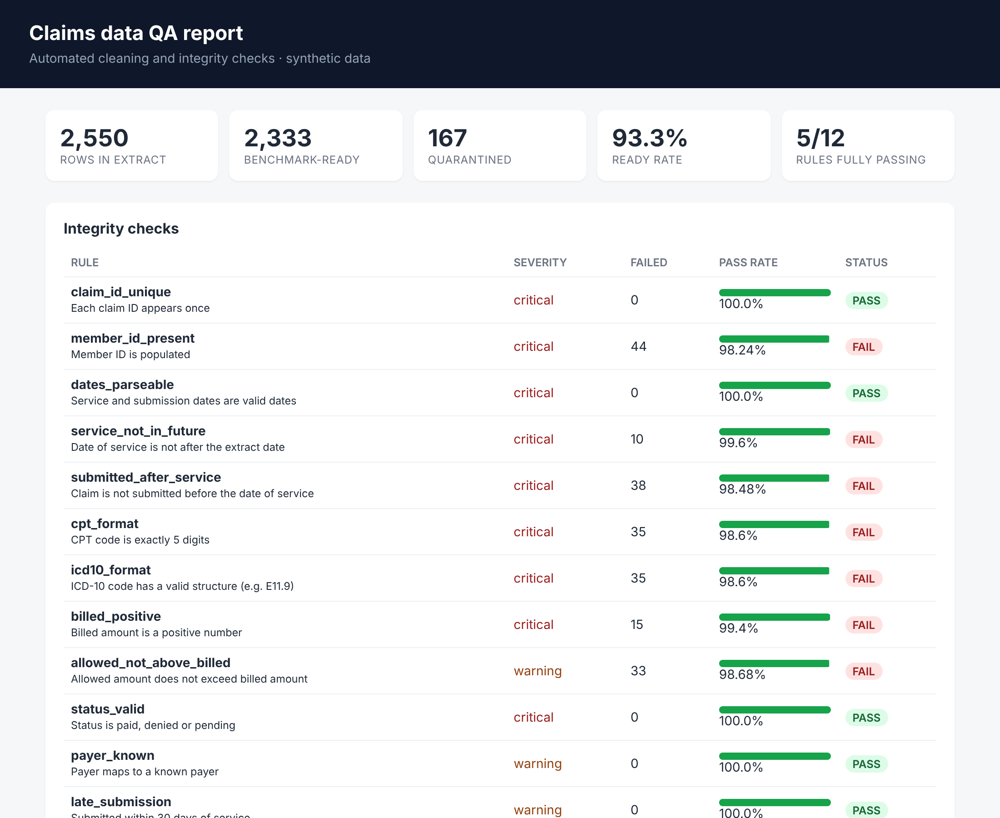

# Claims Data QA Automation

[](https://github.com/mprantikk/claims-data-qa-automation/actions/workflows/ci.yml)


A Python pipeline that takes a messy healthcare claims extract, cleans it, runs automated integrity checks, and splits the rows into **benchmark-ready** and **quarantined**, with an HTML failure panel for the reviewer.

It is a public, synthetic version of the kind of cleaning and QA workflow I run on real claims data at work, where automating these steps replaced most of the manual checking.



## The problem

Claims extracts from practice-management and EHR systems are never clean:

| Defect | Example |
|---|---|
| Four date formats in one column | `2025-03-04`, `03/04/2025`, `04-Mar-2025`, `20250304` |
| Free-text payer names | `BLUESTAR HEALTH`, `Bluestar Hlth`, ` BlueStar Health ` |
| Currency formatting | `$1,234.50` next to `1234.5` |
| Re-run exports | exact duplicate rows |
| Impossible values | submitted before service, future dates, negative charges, allowed above billed |
| Malformed codes | 4-digit CPT, ICD-10 without its dot |

Checking this by hand is slow and error-prone, and one bad row can skew a benchmark.

## How it works

```
raw extract ─► clean (6 logged steps) ─► QA rules (12 checks) ─┬─► claims_benchmark_ready.csv
                                                              ├─► claims_quarantine.csv
                                                              └─► qa_report.html · qa_summary.json · qa_failures.csv
```

**Cleaning** (`claimsqa/clean.py`): small, pure steps, each writing an audit line: deduplicate, trim, parse dates across formats, strip currency, map payer variants to canonical names, standardise status.

**QA rules** (`claimsqa/rules.py`): declarative, so adding a check is one line:

```python
Rule("cpt_format", "critical", "CPT code is exactly 5 digits",
     lambda d: ~d["cpt_code"].astype(str).str.match(r"^\d{5}$")),
```

`critical` failures are quarantined; `warning` failures stay in the data but are flagged for review.

## Run it

```bash
git clone https://github.com/mprantikk/claims-data-qa-automation.git
cd claims-data-qa-automation
pip install -r requirements.txt
python -m claimsqa run                       # uses data/raw_claims_extract.csv
open reports/qa_report.html
```

Sample output:

```
Cleaning:
  - drop_exact_duplicates: removed 50 duplicate rows
  - parse_dates: standardised 2 date columns from 4 formats (0 unparseable)
  - parse_amounts: stripped currency symbols from 721 values
  - standardise_payers: mapped 1739 payer name variants to 5 payers
  ...
2,333 of 2,500 rows benchmark-ready (93.3%), 167 quarantined. Finished in 0.07s.
```

Other options: `python -m claimsqa generate --rows 10000` creates a fresh synthetic extract; `--fail-on-critical` makes the run exit non-zero, so it can gate a scheduled pipeline.

## Tests and CI

8 pytest tests cover each cleaning step, each rule tripping on its own defect, the critical/warning quarantine split, and a full end-to-end run. GitHub Actions runs them, then runs the pipeline and uploads the HTML report as a build artifact.

## Layout

```
claimsqa/
├── generate.py   synthetic messy extract (seeded)
├── clean.py      logged cleaning steps
├── rules.py      declarative QA rules + quarantine split
├── report.py     HTML failure panel + JSON summary
└── __main__.py   CLI
```

All data is synthetic. Built by [Masud Parvej](https://mprantikk.github.io/).
